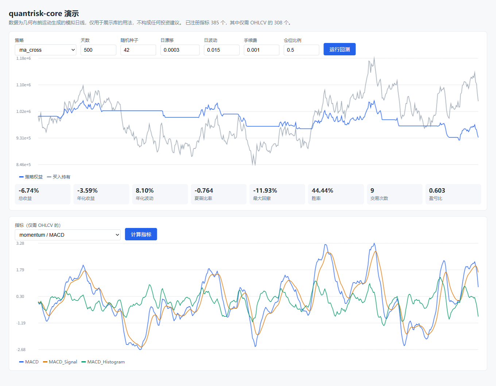
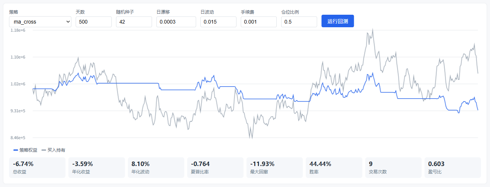
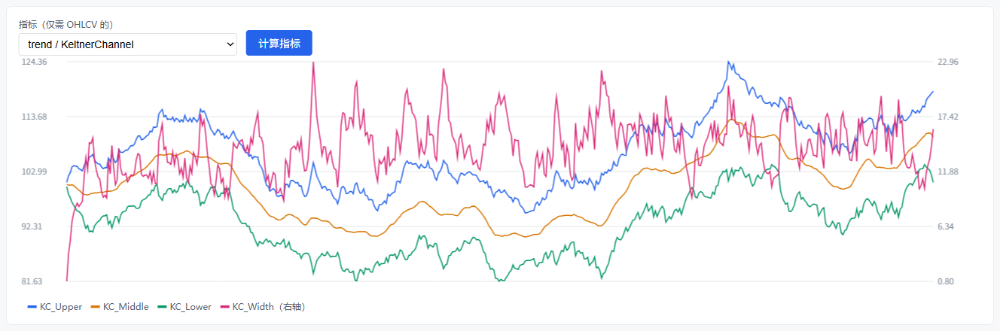
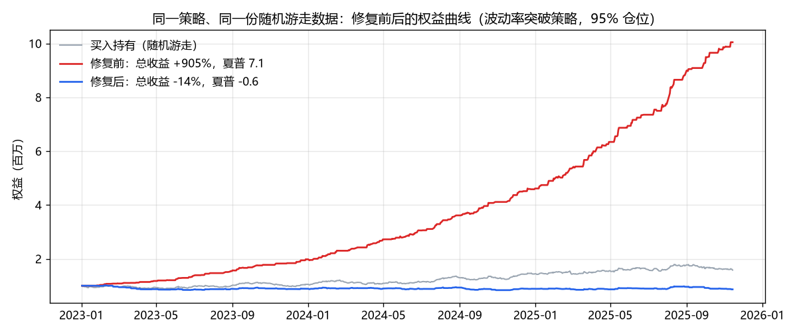

# quantrisk-core


[](LICENSE)

一个纯 Python 的量化工具库：技术指标、策略回测、因子研究、DCF 估值，附带一个本地浏览器演示页面。

代码从个人项目 QuantRiskPro 中抽出，只保留和具体业务、数据源、部署无关的计算部分。抽取过程中发现并修复了回测收益计算里的一个**前视偏差**，详见[下文](#回测里的前视偏差修复前后对比)。

> 仅用于学习与研究，不构成任何投资建议。



## 目录

- [功能概览](#功能概览)
- [快速开始](#快速开始)
- [本地演示](#本地演示)
- [回测里的前视偏差：修复前后对比](#回测里的前视偏差修复前后对比)
- [项目结构](#项目结构)
- [测试](#测试)
- [已知问题](#已知问题)

## 功能概览

| 模块 | 内容 |
|---|---|
| `quantrisk.indicators` | 385 个注册指标，分 17 类：趋势、动量、波动率、成交量、统计、形态、周期、多因子、情绪、微观结构、衍生品、跨市场、宏观联动、执行质量、高级统计、机器学习特征、自定义；统一注册表、批量计算器，可选 Numba 加速 |
| `quantrisk.strategies` | 20 个可直接运行的策略（均线交叉、海龟、MACD、布林回归、RSI 回归、唐奇安通道、波动率突破、网格、时序动量等），以及回测引擎、组合回测、蒙特卡洛模拟、Walk-Forward 优化、报告生成 |
| `quantrisk.factor_research` | 因子库、因子分析（IC、分组收益）、因子合成 |
| `quantrisk.valuation` | DCF 估值 |

关于指标的验证程度，说明如下：

- 只给 OHLCV 时，有 310 个指标能直接算出结果；其余 75 个需要额外的输入列（买卖盘、财报字段、参照资产等），缺列时会明确抛出 `MissingColumnError` 或 `KeyError`。
- 目前对照独立实现验证过数值的只有 SMA、EMA，RSI 只检查了取值范围。其余指标只保证“能运行”，**数值正确性还没有逐个核对**。

## 快速开始

```bash
git clone https://github.com/MengdanXue/quantrisk-core.git
cd quantrisk-core
pip install -e ".[dev]"     # 最小安装：pip install -e .
```

`statsmodels`（协整类指标）和 `scikit-learn`（ML 特征类指标）是可选依赖，分别对应 `[stats]` 和 `[ml]`。

### 计算指标

```python
import importlib, pkgutil
import quantrisk.indicators
from quantrisk.indicators.registry import indicator_registry

# 指标通过装饰器注册，先导入全部子模块
for m in pkgutil.walk_packages(quantrisk.indicators.__path__, "quantrisk.indicators."):
    importlib.import_module(m.name)

# df：以日期为索引，含 open / high / low / close / volume 列的 DataFrame
rsi = indicator_registry.create_indicator("RSI").calculate(df)
macd = indicator_registry.create_indicator("MACD").calculate(df)   # 返回 MACD / Signal / Histogram 三列

print(indicator_registry.get_category_stats())     # 各类别指标数量
print(indicator_registry.search("bollinger"))       # 按关键字查找
```

### 运行回测

```python
from quantrisk.strategies import get_strategy, list_strategies

result = get_strategy("ma_cross", {"position_pct": 0.5}).run(
    df, initial_capital=1_000_000, commission=0.001, slippage=0.0005
)
print(result.metrics)          # total_return / sharpe_ratio / max_drawdown / win_rate / ...
result.equity_curve.plot()     # 权益曲线（pandas Series）
```

回测按**当根 K 线收盘价**成交，信号在收盘时产生，成交后的持仓从下一根 K 线开始计算收益。

## 本地演示

```bash
pip install -e ".[demo]"
uvicorn demo.app:app --port 8765
```

打开 <http://127.0.0.1:8765>。演示使用几何布朗运动生成的模拟行情，不读取任何外部数据。

**策略回测**：选择策略，调整天数、随机种子、漂移、波动、手续费和仓位比例，查看权益曲线（蓝）与买入持有（灰）的对比，以及收益、夏普、回撤、胜率等指标。



**指标计算**：下拉框列出 308 个只需 OHLCV 就能计算的指标。量级差别大的输出（例如通道宽度）会自动画在右侧坐标轴上。



## 回测里的前视偏差：修复前后对比

原实现在成交那根 K 线上，用**成交后的持仓**乘以“上一根到这一根”的价格变化来计算当根收益：

- 买入当根：明明是收盘才买入，却拿到了当根的涨幅；
- 卖出当根：明明持有到收盘才卖出，却漏掉了当根的跌幅。

突破类策略恰好在“当根上涨”时买入、“当根下跌”时卖出，所以这个偏差会被系统性放大。下图是同一个策略在同一份**随机游走**数据上的结果。随机游走本来不可预测，任何策略的期望收益都应接近零：



修复方式是把当根收益改为“本根期末权益 ÷ 上一根期末权益 − 1”（[`strategies/base.py`](src/quantrisk/strategies/base.py)）。`tests/test_strategies.py::test_no_lookahead_when_trading_at_close` 构造了一个“偷看当根涨跌”的策略：在收盘成交的规则下，它不应该赚到钱。这个测试在原代码上 5 个随机种子全部失败，修复后全部通过。

复现上图：

```bash
python scripts/lookahead_comparison.py /path/to/a/CJK/font.ttf
```

## 项目结构

```
quantrisk-core/
├── src/quantrisk/
│   ├── indicators/          # 指标：base / registry / engine + 17 个类别子包
│   ├── strategies/          # 策略 + backtest/（引擎、组合、蒙特卡洛、WFO、报告）
│   ├── factor_research/     # 因子库、分析、合成
│   └── valuation/           # DCF
├── demo/                    # FastAPI 演示服务 + 单页前端（无外部依赖）
├── scripts/                 # 修复前后对比图的生成脚本
├── tests/                   # pytest
└── docs/images/             # README 截图
```

## 测试

```bash
pytest
```

当前共 35 个测试，覆盖：

- 指标注册表；SMA、EMA 与 pandas 实现的数值对照；RSI 的取值范围；
- 全部指标在只有 OHLCV 输入时“要么能算、要么明确报缺列”；
- 20 个策略都能跑通；前视偏差回归测试；满仓持有时的权益守恒；
- 演示服务的 API。

## 已知问题

- `advanced_pairs` 在策略注册表里，但它的构造函数不接受 `params` 参数，所以 `get_strategy("advanced_pairs")` 会报错。演示和测试都暂时跳过了它。
- 大部分指标的数值还没有和 TA-Lib 等成熟实现逐个对照。
- 部分代码注释和指标显示名是中文。

## 许可证

MIT，见 [LICENSE](LICENSE)。
